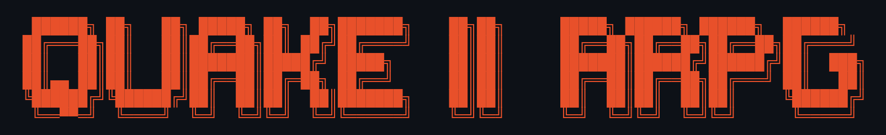

<p align="center"></p>

# Q2ARPG — Quake II: The Action RPG

**Kill. Loot. Level up. Repeat.**

A looter-boomer-shooter mod for the Quake II rerelease (2023). Every gun is rolled
with a rarity, a maker, parts and sometimes an element. Level up, pick a skill
tree, shop at vendors, chase challenges, and replay the campaign in New Game+.

**Version 0.9.4 (public alpha).** The version is shown in the console when
the mod loads. See [`CHANGELOG.md`](CHANGELOG.md) for what changed in each version.
Download the latest release: https://github.com/Rizilla-OG/q2arpg/releases

> **Public alpha:** expect bugs and balance changes. Saves may not carry over
> between versions.

Single-player and co-op (including split-screen). Deathmatch is left stock.

---

## Requirements

- **Quake II** (the 2023 rerelease by Nightdive / id Software), Steam version.
  The GOG rerelease should work the same way but is untested.
- Windows, or Linux through Steam Proton.

## Install

1. Find the game's `rerelease` folder:
   - **Steam, Windows:** `C:\Program Files (x86)\Steam\steamapps\common\Quake 2\rerelease`
     (or right-click Quake II in Steam → *Manage* → *Browse local files*, then open `rerelease`).
   - **Steam, Linux:** `~/.local/share/Steam/steamapps/common/Quake 2/rerelease`
2. Copy the `q2rpg` folder from this download into it, so you have:

   ```
   rerelease/
     baseq2/
     q2rpg/
       game_x64.dll
       autoexec.cfg
       README.md
       CHANGELOG.md
       LICENSE.txt
   ```

Uninstall: delete the `q2rpg` folder. Your normal Quake II saves are untouched.

## Launch

In Steam: right-click **Quake II** → *Properties* → *Launch Options*, and enter:

```
+set game q2rpg
```

Start the game and begin a **New Game**. Clear the launch option to play
stock Quake II again.

To check it loaded, open the console (`~`) after the map starts: you should
see the Q2ARPG logo and `q2rpg game DLL loaded, v<version>`.

## How to play

### Controls

The mod sets these binds in `q2rpg/autoexec.cfg`:

| Key | Action |
|-----|--------|
| `E` | Take the loot you're standing on |
| `G` | Drop your active gun |
| `I` | Loadout (press again for held gun details) |
| `X` | Sell the loot you're standing on, else your active gun (press twice) |
| `B` | Send the loot you're standing on to your stash |
| `V` | Vendor (first visit per map is free) |
| `K` | Skills (press again for the NG+ tier-4 page) |
| `J` | Challenges |
| `F` | Action skill |
| `Q` | Throw grenade |
| `R` | Reload |
| Hold right mouse | Zoom |
| `1`–`9` | Weapon slots; pick skills / shop items while a screen is open |

Controller binds exist for split-screen but are **beta**.

### The loop

- **Guns** drop from monsters in six rarities: Common, Uncommon (green),
  Rare (blue), Epic (purple), Legendary (gold) and, in NG+ only, Mythic.
  Floor loot shows a colored beam for its rarity. Walk over a gun to see
  its card and compare it with yours.
- **Elements:** fire burns, shock staggers and cuts power armor, corrosive
  melts and makes targets take more damage. Afflicted monsters glow.
- **Levels and skills:** kills give XP. Each level gives a skill point. Pick
  one of three trees (Gunner, Juggernaut, Elementalist); each has its own
  action skill on `F`. Once a tree is full, spare points go into Mastery
  (+1% to the tree's main stat each).
- **Shields** absorb damage and recharge; some have special effects.
- **Grenade mods** change what `Q` throws (Frag, Cluster, Sticky, Vortex,
  Leech, Hopper, Airburst). Hand grenades are the ammo. Legendary mods get a
  twist, and each skill tree boosts grenades its own way.
- **Cash and vendors:** sell loot, buy guns, ammo and permanent upgrades.
  The workshop (`9` twice in the shop) levels your gun up to yours. The
  Second Chance upgrade can leave you at 1 HP for 5 seconds instead of dying:
  get a kill to get back up.
- **Challenges** (`J`) pay XP and cash for kill goals. In NG+ a fourth tier
  drops a Mythic reward and a permanent badge.
- **Alphas** are elite monsters with better drops.
- **Menus** (`V`, `K`, `J`, `I`) pause the game in single-player.
- **New Game+:** finishing the campaign restarts it with tougher monsters,
  better loot, Mythic gear, Alpha traits, map modifiers, a level cap of 60
  and a fourth skill row. Each map rolls a modifier, shown when you enter;
  reloading keeps it.

### Co-op

Host a co-op game as usual with the launch option set. Each player gets
their own drops and cash. Players joining mid-game start at the party's
level.

## Options

Enter these in the console (`~`). They are saved.

| Setting | Effect |
|---------|--------|
| `cl_loot_damagenums 0` / `1` | Damage numbers off / on (default on) |
| `cl_loot_healthbar 0` / `1` | Monster health bars off / on (default on) |
| `cl_loot_fov43 0` | Use if health bars drift sideways from monsters on a widescreen display |
| `g_loot_logs 0` / `1` | Local stat logs off / on (see below) |

## Stat logs (local only)

Q2ARPG writes two plain-text files in the `q2rpg` mod folder to track your
run for balancing and bug reports:

- `loot_stats.csv`: one row per map (kills, loot drops, cash, level, grenades).
- `q2rpg_events.log`: one line per event (map entered and its modifier,
  level ups, challenge tiers, Second Chance, deaths).

They stay on your computer. The mod has no network code and **never sends
any data anywhere**. Both files only grow; delete them any time.

To turn them off, open the console (`~`) and enter:

```
g_loot_logs 0
```

The setting is saved. Use `g_loot_logs 1` to turn logging back on.

## Troubleshooting

**No logo in the console / it plays like stock Quake II**
- Check the launch option is exactly `+set game q2rpg`.
- Check the folder is `rerelease/q2rpg` (not `rerelease/q2rpg/q2rpg`) and
  contains `game_x64.dll`.

**Keys don't do anything**
- Binds in `autoexec.cfg` apply after a full restart of the game, not a map
  change. If you rebound keys yourself, re-bind them in the console, e.g.
  `bind e "loot_take"`.

**Lost skill points after going back to an older version**
- Saves from a newer version can lose skill ranks in an older one. Keep the
  latest version.

**Crash when updating**
- Don't replace `game_x64.dll` while the game is running. Quit first.

**Where are my saves?**
- Windows: `C:\Users\<you>\Saved Games\Nightdive Studios\Quake II\q2rpg\save\`
- Linux (Proton): `~/.local/share/Steam/steamapps/compatdata/2320/pfx/drive_c/users/steamuser/Saved Games/Nightdive Studios/Quake II/q2rpg/save/`

**Reporting a bug**
- Include the version from the console, the log file `stdout.txt` from
  the `Saved Games\Nightdive Studios\Quake II\` folder above, and if you
  like, `loot_stats.csv` and `q2rpg_events.log` from the `q2rpg` mod folder.

## For modders

Q2ARPG works with custom maps and campaigns: put your `.bsp` files in the
`q2rpg/maps/` folder and loot, XP, cash, elites, challenges and map modifiers
apply automatically. Mappers can also tag monsters as Alphas, Omegas or
bosses (with their own signature guns), place guns, shields and grenade mods,
drop loot from triggers, tune each map (monster levels, drop rate, Alpha
chance, a forced modifier, a starting level), turn off the vendor or
modifiers, and end a custom campaign into New Game+. The zip includes a
TrenchBroom game config with all of it, and an example map (`map q2rpg_example`)
that walks through every feature, one room each.

Gun stats, manufacturers, rarities and vendor prices live in a data file
(`loot_data.json`), so they can be changed without touching C++. See
[MODDING.md](MODDING.md) for every key, the data file, the TrenchBroom setup and
how to compile.

## Ideas and feedback

This is an alpha, and player feedback shapes where it goes next. Got an idea
for a new gun, skill, monster twist or map modifier? Think something is too
strong, too weak, or just not fun? [Open an issue](https://github.com/Rizilla-OG/q2arpg/issues) or [start a discussion](https://github.com/Rizilla-OG/q2arpg/discussions) on
GitHub with your ideas, recommendations and requested changes. Big or small,
every suggestion gets read.

## Dedication

To the teams at id Software and Nightdive Studios: thank you. Quake II has
given us decades of memories, from late nights on dial-up deathmatch to
co-op runs through the Strogg homeworld with friends. id built a game that
still feels incredible to play almost thirty years later, and then shared
its source so people like us could keep tinkering with it. Nightdive
brought it back with care and respect, and kept the door open for modders
with the rerelease and its game source. None of this would exist without
your hard work. This mod is dedicated to you.

---

Quake and Quake II are trademarks of id Software / ZeniMax Media. This is an
unofficial fan mod, not affiliated with or endorsed by them. Game code is
based on id Software's Quake II rerelease game source (GPL v2).
